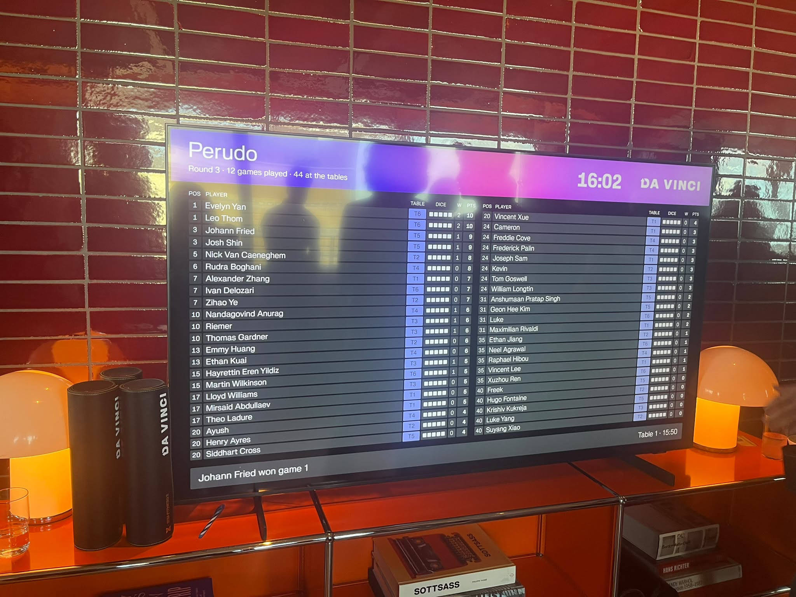
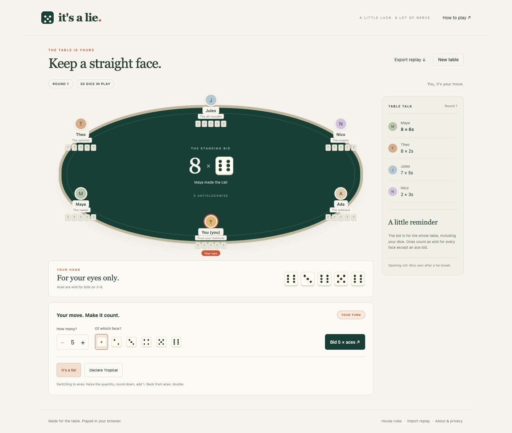

# It's a Lie — A twist on the classic 'Perudo'!

## Motivations

I really enjoyed playing Perudo and thinking about Da Vinci's variant, It's a Lie, which we played at the Da Vinci brunch in London. Hence, I created this website to simulate playing with (relatively intelligent) bots in this Perudo-style game with the twists I thought made the classic game more interesting.

You can play with up to 1-5 bots, and toggle dice odds and implied dice odds, which I hope would be educational to help improve how to play the game. You can choose which house rules to play with as well.

I was able to win a free trip to Amsterdam, although I was visiting there this December anyways, but who says no to a free trip? I was in joint first place after round 2 here, before absolutely tanking it in the third (and final) round. I should really stop feeling so tempted to call Calza ('Exact'), although I lost two die due to the 'first one-die blind' house rule by accidentally looking at my hand (I was not locked in enough to keep track of who fell to one dice).



## Preview

Honestly, the website is mainly just here for me to play the game instead of hosting it on my local machine. I would say real-life gameplay definitely involves more psychological strategy, but you definitely need a good mathematical foundation for it nevertheless!



Delivery checks are recorded in [VERIFIED.md](docs/VERIFIED.md).


## Features

- 2–6 seats, five distinct bot personalities, three difficulty levels.
- Dudo, Calza, bluffable Tropical declarations, a one-time blind round, and a persistent Shootout finale.
- A legal bid picker, direction choice, round reveals, table history, and in-app rules.
- Responsive desktop and mobile layouts, keyboard controls, reduced-motion support, system fonts, no downloaded art.
- Toggle **Show odds** during a game to see your dice-only coverage, Dudo, and exact-count probabilities, plus a live preview of the raise selected in your bid picker.
- Optional soft bidder-support model: assume the standing bidder holds at least one or two matching dice, with an adjustable 0–100% mixture weight (default 20%). Raw and adjusted views remain distinct. See [ODDS.md](docs/ODDS.md).
- Automatic local save/resume. JSON replay export/import reconstructs and validates every move; an imported replay can be continued.
- Worker-based AI. Each decision receives only that seat's permitted observation. A failed worker times out and uses a legal fallback.
- Decision notes become visible only after a full reveal. Tropical partial reveals keep private analysis hidden.

## Project map

```text
index.html              Website entry
src/engine.js           Pure rules and state transitions; legal actions; replay
src/random.js           Seeded dice RNG and independent decision RNG helpers
src/ai.js               Human-style bot reasoning and public-reveal learning
src/odds.js             Observation-only live coaching and soft support scenarios
src/worker.js           Isolated bot message handler
src/app.js              UI, saves, replay import/export, turn scheduling
src/styles.css          Responsive visual design
scripts/                Build, local server, syntax check, simulation
test/                   Node standard-library tests
.github/workflows/      Checks and GitHub Pages deployment
docs/                   Rule decisions, AI design, verification and limitations
```

